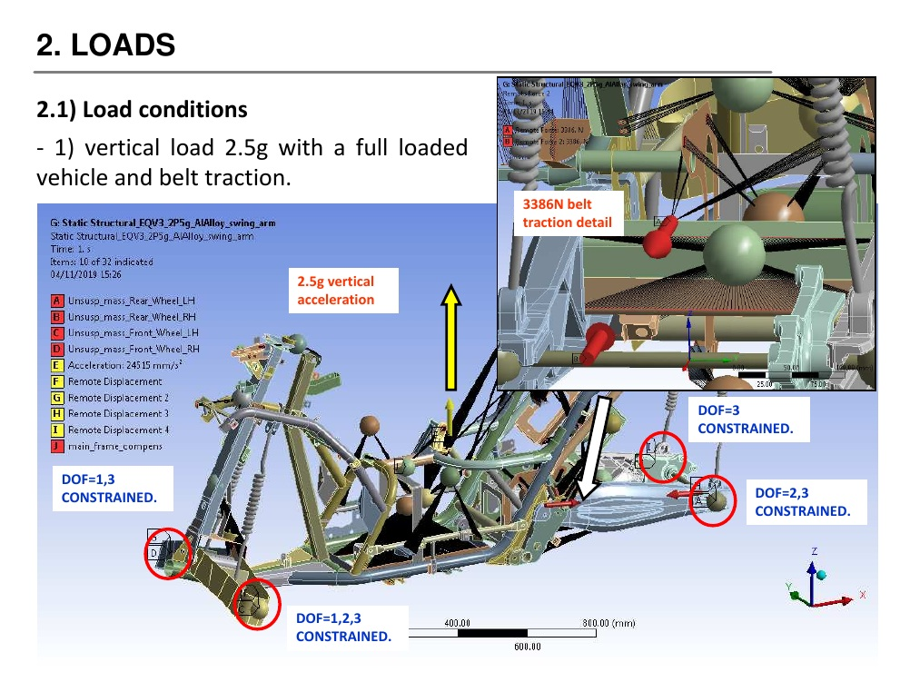
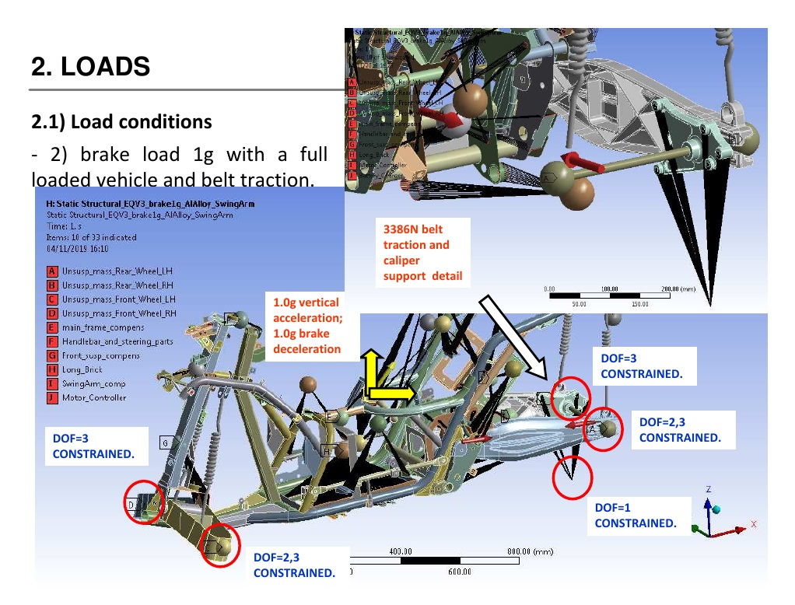
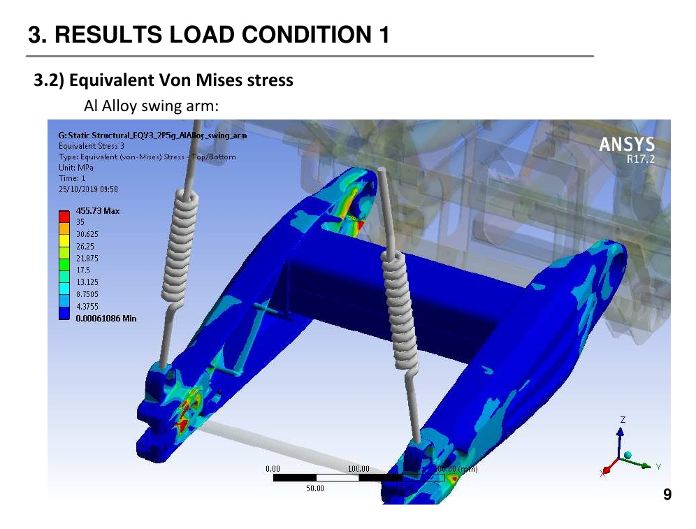
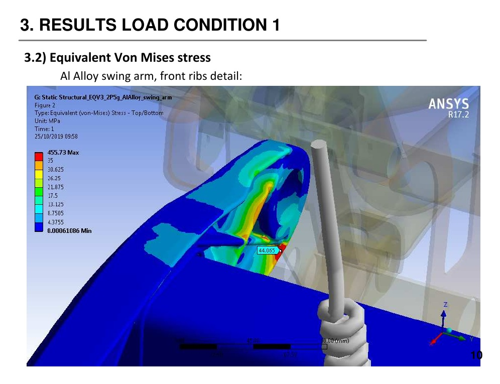
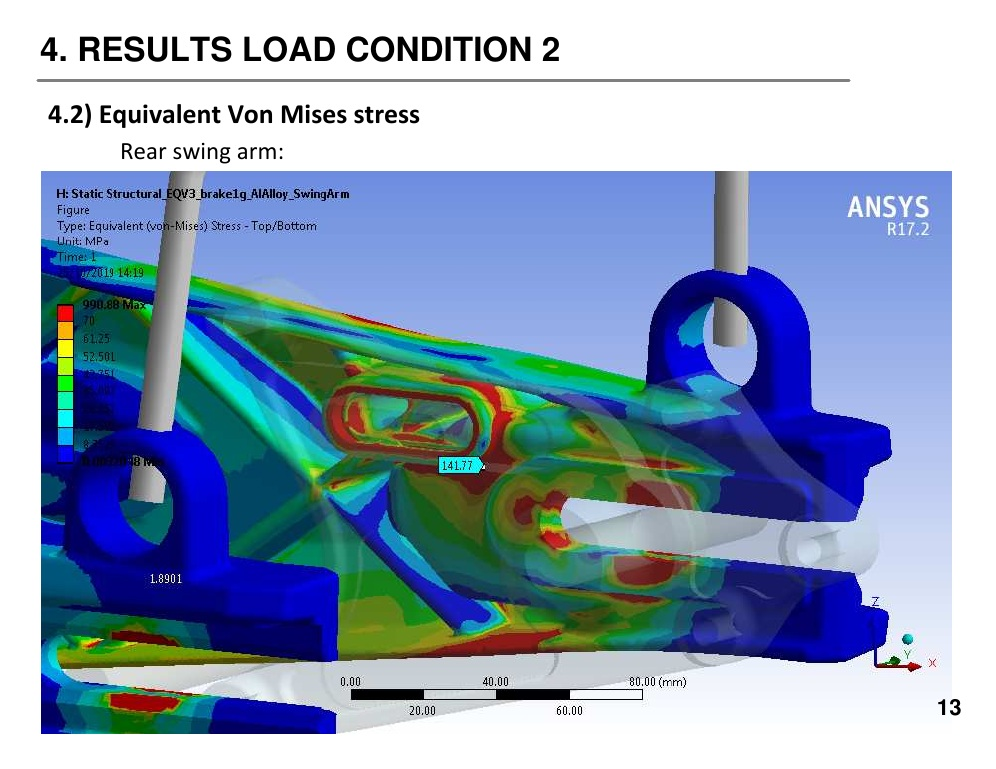
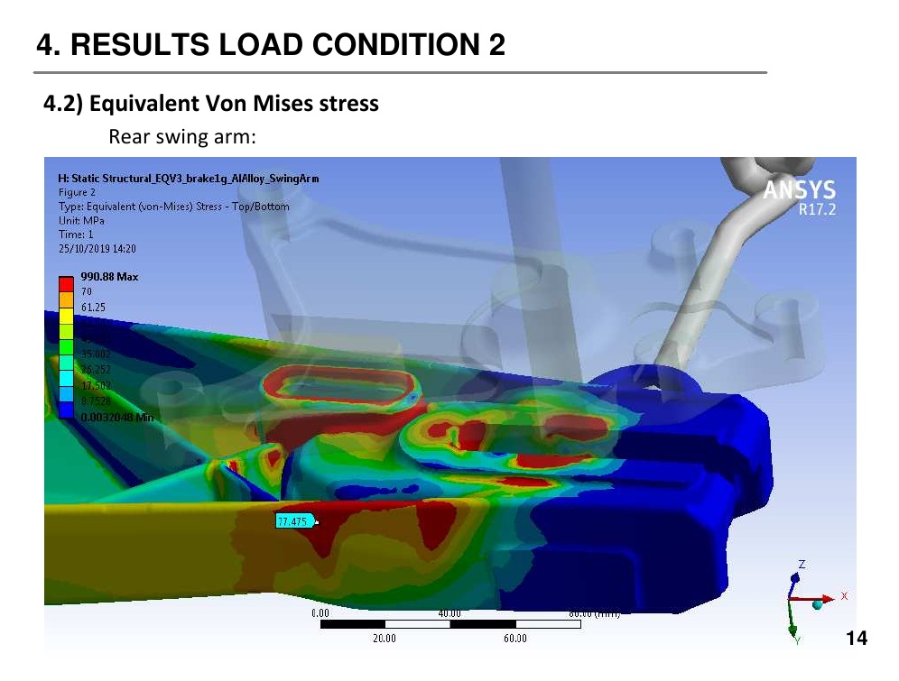
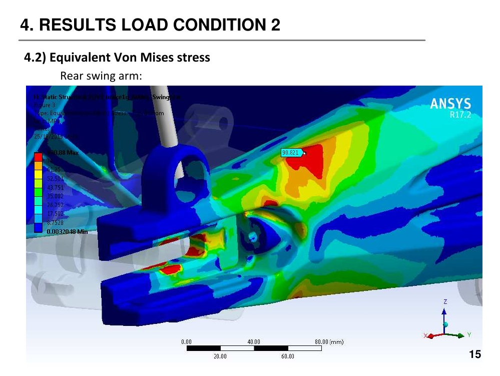
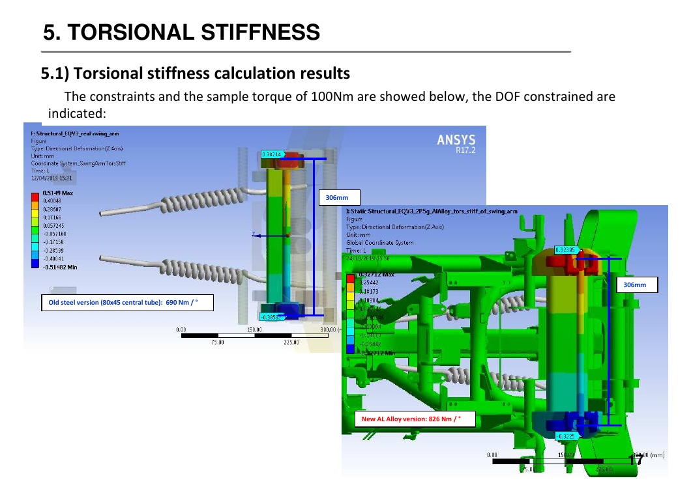

[README.md](https://github.com/user-attachments/files/34631374/README.md)
# QV3 Electric Powertrain Conversion & Rear Swing-Arm Development

**Vehicle electrification · Mechanical architecture · Powertrain integration · Structural FEA · Design iteration**

## Project overview

Mechanical development of the electric conversion of the QV3 three-wheel vehicle platform, originally designed around an internal-combustion powertrain. The work involved adapting the existing chassis architecture to a fully electric rear-wheel-drive configuration, including the mechanical interfaces required to mount and integrate the electric motor and belt transmission.

A second major workstream covered the design and structural development of an aluminium rear swing-arm configuration. The design was assessed under representative vertical, braking and torsional load cases, with FEM results used to identify critical regions and drive design modifications.

## My contribution

I was directly involved in the three core engineering activities:

- **Electric powertrain integration:** designed the mechanical motor mounting arrangements and interfaces required to integrate the electric motor and belt-driven transmission into the existing vehicle architecture.
- **Aluminium rear swing-arm development:** personally designed the revised aluminium swing-arm configuration, managing its mechanical interfaces with the chassis, suspension, rear wheel and brake-caliper support.
- **FEM-driven design iteration:** contributed directly to load-case definition, review and interpretation of ANSYS results, identification of critical stress regions and subsequent design modifications.

The development process combined CAD design, mechanical integration and structural assessment to balance packaging, stiffness, strength and manufacturability.

## Electric vehicle configuration

The supplied QVe technical brochure lists:

| Parameter | Published specification |
|---|---:|
| Motor | Z-Force® 75.5 brushless |
| Peak power | 34 kW (46 hp) |
| Continuous power | 18 kW (24.5 hp) |
| Peak torque | 106 Nm |
| Battery | Z-Force® lithium-ion |
| Capacity | 7.2 kWh |
| Declared range | 110 km |
| Secondary transmission | Reinforced belt |
| Final drive | Toothed belt |
| Driven wheel | Single rear wheel |
| Curb weight | 227 kg |

*Source: QVe technical brochure supplied for this portfolio case study.*

## Structural FEM assessment — aluminium rear swing arm

The supporting report, *EQV3 Rear Swing Arm Al Alloy FEM Analysis* (tec.rep.873, revision 00, 20 November 2019), evaluates an aluminium rear swing-arm configuration on the EQV3 vehicle. The report shows ANSYS R17.2 and assumes a generic aluminium alloy with a yield strength of **140 MPa**. It refers to report `rep.771` for further FEM model and constraint details.

### Load cases

| Case | Conditions | Additional load |
|---|---|---:|
| Vertical | 2.5 g, fully loaded vehicle | 3,386 N belt traction |
| Braking | 1.0 g braking + 1.0 g vertical acceleration | 3,386 N belt traction |
| Torsional stiffness | 100 Nm applied torque | Constraints as defined in source report |

The braking case assumes that all braking force is generated by the rear disc.

### Reported torsional stiffness

| Configuration | Torsional stiffness |
|---|---:|
| Previous steel version (80 × 45 central tube) | 690 Nm/° |
| New aluminium-alloy version | 826 Nm/° |

The aluminium configuration shows a **19.7% increase in reported torsional stiffness** relative to the steel reference under the report's comparison setup.

### Critical findings and design iteration

The stress contour legends show local maxima of approximately **455.73 MPa** for the vertical load case and **990.88 MPa** for the braking case. These values exceed the assumed 140 MPa yield strength and were treated as critical areas for engineering review, not as a passed strength verification.

The report's conclusion specifically identifies the connection between the brake-caliper support and the swing arm as requiring modification. This finding informed the design-review and modification activity.

## FEM visual evidence

The following figures are selected directly from the supplied ANSYS report. They show the load cases, equivalent von Mises stress contours and torsional-stiffness assessment. Captions distinguish the source report's simulation outputs from interpretation.

### Load cases and boundary-condition illustrations

| Vertical loading | Braking loading |
|---|---|
|  |  |

### FEM results — vertical load case

### FEM results — braking load case

### Torsional stiffness assessment

*Figures are reproduced from the supplied FEM report (tec.rep.873, rev.00, 20 November 2019). The reported local stress maxima exceed the assumed 140 MPa yield strength; the source report calls for modification of the brake-caliper-support/swing-arm connection. These figures are evidence of the analysis and design-review process, not proof that the original configuration passed structural verification.*

## Confidentiality

Publish only information and images you are authorized to disclose. Do not upload proprietary CAD, detailed manufacturing drawings, restricted source files or confidential vehicle data without explicit permission.
